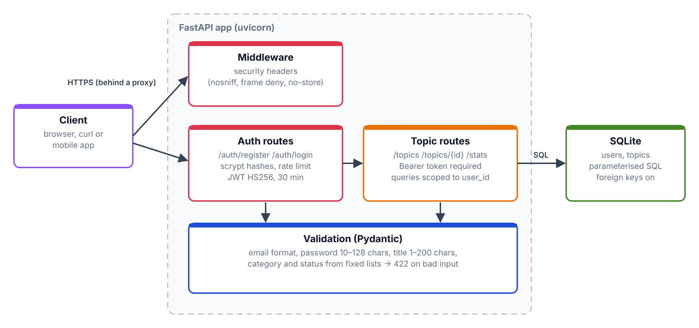

# Study tracker API (backend starter)

A small, secure-by-default REST API for the backend project: users register, log in with a JWT, and track study topics (DSA, Core CS, security, cloud, AI) with status and revision counts. Python 3.10+, FastAPI, SQLite. 10 tests cover the security behaviour, not just the happy path.



## Run

```bash
python3 -m venv .venv && . .venv/bin/activate
pip install -r requirements.txt
export JWT_SECRET=$(python3 -c "import secrets; print(secrets.token_hex(32))")   # never commit it
uvicorn app.main:app --reload            # interactive docs: http://127.0.0.1:8000/docs
pytest -q                                # 10 tests
```

## Endpoints

| Method | Path | Auth | What it does |
|---|---|---|---|
| GET | `/health` | no | Liveness check |
| POST | `/auth/register` | no | Create a user (email, password of 10–128 characters) |
| POST | `/auth/login` | no | Returns a bearer token (HS256, 30 minutes); 5 attempts per minute per IP and email |
| GET | `/topics?status=done` | yes | Your topics, optionally filtered |
| POST | `/topics` | yes | Add a topic: `{"title": "...", "category": "dsa"}` |
| PATCH | `/topics/{id}` | yes | `{"status": "done", "revised": true}` |
| DELETE | `/topics/{id}` | yes | Delete one of your topics |
| GET | `/stats` | yes | Counts per category and status, total revisions |

## Security checklist

| Area | Done here | How it is tested |
|---|---|---|
| Password storage | scrypt with a random 16-byte salt per user (standard library); constant-time comparison | Stored value is not the password and verifies correctly |
| Authentication | JWT HS256 with expiry; algorithm list fixed on decode; secret from the environment, at least 32 characters, checked at startup | Missing, malformed, forged, expired and `alg: none` tokens all get 401; weak secret refuses to start |
| Authorisation (IDOR) | Every topic query includes `user_id = ?`; another user's topic returns 404, the same as a missing one | User B cannot list, update or delete user A's topic |
| Injection | Parameterised SQL only; no string-built queries | A `DROP TABLE` title is stored and returned as plain text |
| Input validation | Pydantic models: email format, length limits, fixed category and status lists | Empty, too long and unknown values return 422 |
| Brute force | Sliding-window login limit (5 per minute per IP and email) | The sixth attempt returns 429 |
| User enumeration | Same message for unknown email and wrong password | Both return "Wrong email or password" |
| Headers | `nosniff`, `X-Frame-Options: DENY`, `no-referrer`, `no-store` | Checked on `/health` |

## Before putting it online

- Serve it behind HTTPS (a reverse proxy or the platform's TLS); add HSTS there.
- Move the rate limiter to Redis or the gateway if you run more than one process.
- Add refresh tokens or short sessions plus logout (a token deny-list) if you need sign-out.
- Use PostgreSQL and migrations (Alembic) instead of SQLite for real users; keep backups.
- Add logging of failed logins without logging passwords or tokens; set CORS to your own front-end origin only.
- Run `pip-audit` (or GitHub Dependabot) for vulnerable dependencies.

## Ideas to extend it (and talk about in interviews)

1. Spaced-repetition scheduling: a `next_review` date that grows after each revision (1, 3, 7, 21 days).
2. Pagination and sorting on `/topics`.
3. A Dockerfile and a GitHub Actions workflow that runs the tests on every push.
4. Load test with `locust` and report requests per second and p95 latency.
5. Deploy on AWS (EC2 or App Runner) with RDS, using what you learn for SAA-C03.
